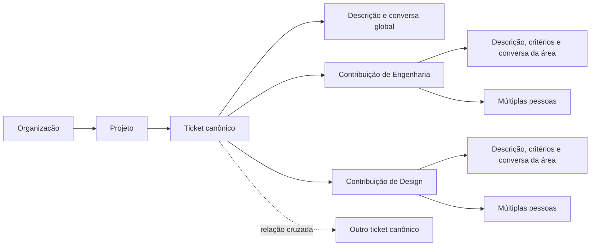

# TreePM — business blueprint da plataforma

**Data:** 2026-11-05. **Estado:** proposta de produto e plano de implementação; a plataforma abaixo ainda não foi implementada. Os itens atuais de engenharia são a engine reutilizável e os indicadores mesclados. Login, API, persistência, busca e IA continuam fora desta entrega.

## 1. Tese de produto

TreePM organiza trabalho coletivo como um território navegável. Aproximar revela execução; afastar revela estrutura, situação e risco. O mesmo trabalho pode ser examinado por objetivo, time, pessoa, área, prazo ou dependência, preservando sua identidade e contexto.

A ruptura principal é tratar um ticket como um compromisso compartilhado entre disciplinas. Design, Engenharia, Produto e outras áreas contribuem no mesmo lugar, com suas descrições, critérios, pessoas e conversas. A informação não precisa ser copiada entre vários tickets departamentais para o trabalho existir.

A navegação espacial é a mecânica principal do site, inclusive para busca, triagem, acompanhamento e reuniões. Lista, calendário e outras projeções podem complementar tarefas específicas, usando os mesmos dados. O mapa precisa ser útil com teclado, movimento reduzido e tecnologia assistiva; informação essencial não pode depender de distinguir cores ou controlar zoom com precisão.

### Para quem e para quê

Público inicial recomendado: times de produto digital com trabalho interdependente entre duas ou mais disciplinas, um responsável por organizar a operação e reuniões recorrentes de acompanhamento. O primeiro piloto deve ser pequeno o suficiente para acompanhar decisões e correções de perto; quantidade de pessoas e volume de tickets serão validados, não presumidos como limite comercial.

| Situação atual | Trabalho que o usuário quer realizar | Resultado esperado |
| --- | --- | --- |
| Tickets departamentais duplicam contexto | Coordenar uma entrega entre áreas | Um compromisso, várias contribuições visíveis |
| Backlogs longos escondem contexto | Entender onde uma demanda pertence | Caminho hierárquico, alternativas e triagem assistida |
| Status exige perguntar a várias pessoas | Identificar o que impede uma entrega | Bloqueios, critérios pendentes e evidências no próprio ticket |
| Reuniões alternam entre buscas e abas | Conduzir uma conversa com roteiro | Stand-up navegável que mantém o contexto |
| Busca depende de lembrar o título | Encontrar o trabalho por intenção | Busca semântica combinada com filtros e referências |
| Cada pessoa mantém listas paralelas | Planejar o dia sem poluir o backlog oficial | Espaço privado ligado às demandas autorizadas |

### Promessa e critérios de diferenciação

1. Chegar ao trabalho certo sem perder o caminho até o objetivo.
2. Entender quem participa e o que cada área precisa entregar.
3. Distinguir conclusão, progresso e impedimento sem depender de uma cor.
4. Transformar reuniões em decisões registradas no contexto.
5. Usar IA para reduzir esforço de organizar e recuperar informação, mantendo pessoas e regras do produto no controle das mudanças.

Não exigir que todos os clientes adotem a mesma metodologia. Fluxos, vocabulário, campos e presets devem ser configuráveis, preservando um núcleo simples de identidade, hierarquia, participação, relações e histórico.

## 2. Mecânica espacial e contrato de interação

### Modelo mental

- Uma árvore mostra a decomposição canônica de um projeto. Um ticket tem no máximo um pai; pode haver várias raízes.
- Cada geração é fisicamente menor. Regiões retangulares determinísticas e zoom contínuo preservam a orientação espacial.
- Afastar comprime filhos em pequenos representantes. Quando vários filhos compartilham um quadrado mesclado, a apresentação guarda exatamente quais IDs ele representa; a cor vem de uma função configurável. Não há badge visual `+N`.
- Aproximar separa os representantes e os transforma nos cards correspondentes. A mesma mecânica funciona na volta.
- Seleção é um estado; navegação é uma intenção explícita. Clicar no card abre contexto sem mover a câmera. Escolher um resultado de busca, uma referência ou um item de roteiro pode selecionar **e navegar**, porque essa ação declara o destino.
- A navegação oferece Voltar/Avançar entre destinos, breadcrumbs e links diretos. Restaurar um link valida acesso antes de carregar o contexto do ticket.

### O que aparece em cada compressão

As faixas abaixo descrevem um orçamento de informação, não obrigam larguras fixas da engine. O produto usa presets configuráveis e oferece detalhes por foco, teclado ou painel. Uma preferência pode destacar prazo ou bloqueio no lugar de outro campo secundário.

| Grau | Informação no card/representante | O que fica sob demanda |
| --- | --- | --- |
| Dot / quadrado | Cor semântica ou mistura dos membros; forma/contorno de alerta quando legível | Nome acessível, quantidade e composição do agrupamento, situação em texto |
| Chip | Identificador curto, título truncado e um sinal prioritário de bloqueio ou atraso | Pessoas, áreas, prazo completo e descrição |
| Compacto | ID, título, situação em texto, progresso derivado quando pai, áreas e participantes resumidos | Listas completas de responsáveis, contribuição de cada área e critérios |
| Completo | Título, situação, prazo, prioridade, progresso, áreas com pendências, participantes, bloqueios e resumo curto | Descrição longa, comentários, histórico e anexos |
| Painel de detalhe | Descrição global, seções de áreas, todos os participantes, critérios, conversas e relações | Conteúdo de anexos e histórico expandido |

Regras de legibilidade:

- Bloqueios e prazos críticos competem por um orçamento explícito de sinais; não acumular ícones ilegíveis.
- Um pai apresenta progresso calculado e contagens. Uma folha apresenta sua situação de execução. Percentual sempre vem acompanhado de base, por exemplo `8 de 12 entregas concluídas`.
- O zoom não dispara downloads de todos os comentários e anexos. Listagem, resumos e detalhes têm carregamentos distintos.
- O painel contém a lista completa de pessoas; uma pilha compacta de participantes nunca sugere que há apenas um responsável.
- A mistura de cores não serve para inferir números exatos. Legenda e alternativa textual mostram composição. Daltonismo, contraste e temas exigem marcadores além da cor.
- O padrão de mistura da biblioteca é uma opção visual; o produto pode trocar o callback para expressar distribuição de status, risco ou área, sem alterar o significado armazenado dos dados.

## 3. Objetos do produto e invariantes

| Objeto | Papel e regra principal |
| --- | --- |
| Organização / tenant | Fronteira empresarial de dados, administração e políticas; associada a uma Clerk Organization |
| Pessoa / membership | Identidade compartilhada e participação na organização; pertencer a uma não concede acesso às demais |
| Time | Grupo operacional de pessoas, com administradores e projetos associados |
| Área | Disciplina ou função, como Engenharia, Design ou Jurídico; não precisa coincidir com um time |
| Projeto | Objetivo e espaço de colaboração com acesso, responsáveis, marcos e árvore próprios |
| Ticket | Unidade canônica de contexto e trabalho; ID estável, projeto, pai opcional, descrição global e participantes múltiplos |
| Contribuição de área | Seção do ticket com área, descrição, critérios de aceite, situação, impedimentos e pessoas assinaladas |
| Participação | Relação entre pessoa e ticket ou contribuição, com papel de contribuição; não é um campo `owner` único |
| Relação cruzada | Entidade separada que liga dois tickets e expressa dependência, associação ou duplicidade |
| Comentário / thread | Conversa com escopo explícito global ou de contribuição de área; mantém autoria e histórico |
| Visualização salva | Filtros, ordenação, perspectiva, campos e preferências de apresentação; não altera o parentesco real |
| Roteiro / sessão de stand-up | Preset e execução de uma reunião, com sequência, destinos e decisões |
| Evento de atividade | Mudança atribuída a uma pessoa, integração ou ação de IA aprovada; permite auditoria e notificações |
| Espaço privado diário | Planejamento pessoal dentro de um tenant, com referências a trabalho oficial acessível |

### Um ticket, várias disciplinas

Exemplo: `TREE-142 — Ativar cobrança anual` contém uma descrição global do resultado esperado. Produto descreve regras e critérios; Design documenta estados e revisão; Engenharia descreve implementação e validação; Financeiro descreve conciliação. Cada seção aceita múltiplas pessoas. Comentários globais discutem a entrega; threads por área discutem aquela contribuição sem fragmentar o ticket em cópias.

Uma pessoa pode contribuir em mais de uma área e um time pode atuar em várias áreas. Pode existir alguém facilitando a coordenação, mas esse papel não substitui os demais responsáveis nem vira uma propriedade obrigatória de dono único.

Se uma contribuição merece decomposição independente, criam-se subtickets reais com vínculo explícito ao critério ou contribuição de origem. Uma thread, checklist ou participação não vira automaticamente um segundo ticket nem conta duas vezes no progresso.

### Estado, critérios e progresso

- Folhas têm situação de execução manual, com transições e campos configuráveis pelo projeto. O primeiro preset pode usar `a fazer`, `em andamento`, `em revisão`, `concluído` e `cancelado`; bloqueio é um impedimento com motivo e não apaga a fase de execução.
- Seções de área registram a situação de sua contribuição e aceite. Marcar uma folha como concluída exige critérios obrigatórios atendidos e contribuições obrigatórias aceitas, ou uma exceção explícita com motivo e permissão. A IA pode sugerir, nunca presumir o aceite.
- Pais não recebem status manual de execução: derivam progresso das folhas descendentes. Ao decompor uma folha em filhos, o trabalho restante deve ser distribuído ou convertido em uma folha explícita, evitando trabalho próprio invisível no pai.
- Progresso padrão conta folhas elegíveis uma vez. Canceladas e arquivadas ficam fora do denominador ativo, com quantidade excluída visível. Progresso por esforço é uma opção futura, com cobertura de estimativas e denominador declarados.
- Filtros não reescrevem o progresso global: apresentar `progresso do projeto` e, quando útil, `progresso do recorte` com bases distintas.
- Participantes múltiplos, referências em outras visões e relações cruzadas nunca multiplicam a contagem de uma entrega.

### Conversas e conhecimento

Comentários têm escopo discriminado: ticket global ou uma contribuição de área existente. Comentário por área é **contextual**, não automaticamente privado: inicialmente herda o acesso ao ticket. Privacidade por seção exige uma decisão posterior explícita de permissão e de experiência de busca.

Threads, menções, reações, anexos, citações de critérios e decisões resolvidas precisam conservar contexto. Mencionar alguém não concede acesso. Editar uma descrição mantém versões; decisões importantes podem ser destacadas sem perder o comentário original. Remoção de acesso não apaga autoria histórica. Exclusão, retenção e anonimização terão política definida antes do piloto com dados reais.

## 4. Fluxos essenciais

### Entrada e configuração

1. A pessoa autentica com Clerk e escolhe ou cria uma organização, conforme a política de onboarding.
2. O administrador convida participantes, cria times e áreas e define quem pode criar projetos.
3. O primeiro projeto nasce com um preset pequeno de workflow, permissões e visualização espacial.
4. Um onboarding guiado cria uma entrega com duas áreas e navega até ela. O objetivo de ativação é colaboração real, não apenas preencher um cadastro.

### Captura e triagem

Uma barra de comando permite escrever uma demanda, colar uma referência ou criar uma captura rápida. O rascunho recebe descrição global, possíveis áreas, pessoas sugeridas, critérios e local provável. A pessoa vê o caminho sugerido, alternativas e mudanças propostas antes de salvar.

Sem IA, o fluxo continua funcionando com criação manual, seleção de pai, busca e atalhos. Se nenhum ramo fizer sentido, a demanda pode permanecer na caixa de entrada do projeto ou ser uma nova raiz, conforme permissão. Não forçar uma categoria apenas para preencher o campo pai.

### Busca semântica que leva ao contexto

- Uma única entrada aceita texto livre, IDs, termos exatos e filtros visíveis. Exemplo: `o que impede o lançamento do plano anual?`.
- A recuperação combina termos exatos, semântica e filtros. IDs exatos têm prioridade previsível. Resultados mostram título, trecho de evidência, caminho, situação, áreas e razão de relevância quando disponível.
- Só conteúdos autorizados entram na busca, nos snippets e no contexto enviado à IA. Contagens, sugestões e sugestões de correção também não podem revelar projetos privados.
- Enter ou escolha explícita navega até o resultado, seleciona-o e abre o painel; prévia no teclado não move a cena a cada tecla. O resultado guarda origem para Voltar restaurar a busca e a câmera anteriores.
- Um ticket escondido por filtro não some silenciosamente: oferecer revelar temporariamente o caminho com indicação de exceção, ou alterar filtros com uma ação explícita. O sistema não muda a visão salva sem avisar.
- Conteúdo ainda não indexado mostra esse estado e continua encontrável por ID e busca lexical quando permitido. Falha da busca semântica não torna o backlog inacessível.

### Execução e acompanhamento

Pessoas atualizam suas contribuições no mesmo ticket. Revisões e aceites apontam para critérios verificáveis. Bloqueios podem citar tickets, decisões externas ou necessidade de uma área; um bloqueio manual tem motivo próprio mesmo sem depender de outro ticket.

Marcos, prazos, prioridade, esforço opcional, capacidade e metas ajudam a planejar. Notificações, inbox e preferências evitam transformar cada comentário em interrupção. Atualizações em tempo real devem indicar alterações concorrentes, presença e conflitos de edição sem sobrescrever texto silenciosamente.

## 5. Filtros e perspectivas

Filtros são uma linguagem de consulta estruturada, com representação visual editável. Texto gerado pela IA vira essa representação para conferência; não uma consulta livre executável contra o banco.

Filtros iniciais: organização ativa, projeto, time, área, participante, autor, situação, bloqueio, prioridade, prazo, marco, etiqueta, campo personalizado e localização em uma subárvore. Adicionar composição `e/ou/não` quando houver demanda comprovada, preservando legibilidade.

| Perspectiva | Comportamento desejado |
| --- | --- |
| Árvore canônica | Preserva posições e parentesco; fora do recorte fica atenuado ou resumido, com ancestrais de contexto |
| Foco no recorte | Enquadra os resultados e mantém referências ao caminho original; a ação é explícita |
| Por pessoa | Agrupa contribuições; um ticket com três pessoas pode aparecer como referência em três grupos, mas continua sendo uma entrega |
| Por área / time | Mostra contribuição e pendências daquela área, conservando a descrição global e os demais participantes |
| Fluxo de execução | Projeta os mesmos tickets por situação, sem transformar colunas em pais da árvore |
| Prazos / calendário | Destaca marcos e compromissos temporais sem duplicar dados |
| Dependências / riscos | Prioriza caminhos de bloqueio e impactos, com relações selecionáveis |

Uma visualização salva pode ser pessoal ou compartilhada. Tem nome, filtros, perspectiva, campos visíveis e acesso; permissões dos dados continuam sendo aplicadas ao abrir. O usuário pode comparar recorte e todo, identificar quantos resultados estão ocultos e limpar filtros com uma ação acessível.

## 6. Relações cruzadas sem destruir a árvore

Parentesco responde `de que entrega isto faz parte?`. Dependência responde `o que precisa acontecer antes?`. Associação responde `que trabalho tem contexto em comum?`. São relações distintas, com IDs, tipos, metadados, autoria e seleção próprios.

- `bloqueia / depende de`: direcionada; impedir ciclos na rede de dependências de execução. Explicar o caminho que formaria o ciclo antes de salvar.
- `relacionado a`: associação sem precedência; ciclos são permitidos porque não representam ordem de execução.
- `duplica`: vincula ao ticket canônico após revisão, preservando comentários e referências; não apaga automaticamente o duplicado.
- Relações entre projetos pertencem ao mesmo tenant e exigem autorização sobre os dois extremos. Relações entre tenants ficam fora do escopo inicial.

No mapa, mostrar arestas de relações relevantes ao foco, seleção ou modo específico. Não desenhar toda a rede sobre toda a árvore. Quando um extremo estiver comprimido, encaminhar a ligação ao representante ou agrupamento que o contém; não criar aresta órfã nem sugerir que o agregado é um novo ticket. Em escalas amplas, agrupar fluxos e exibir detalhes quando selecionados.

Referências em agrupamentos por pessoa ou área são atalhos ao ticket canônico. A projeção pode ter IDs de apresentação próprios e guardar `ticketId`, mas contagens e gravações usam a identidade canônica. Mover uma referência entre grupos não muda `parentId` sem uma ação explícita de reestruturação.

## 7. Stand-up como navegação guiada

Implementar a IDEA-003 completa em etapas, preservando sua intenção:

1. Presets com participantes, times, áreas, projetos e período relevante.
2. Roteiro por pessoa, por ticket ou por trabalho em andamento. Reordenar participantes e passos antes de iniciar.
3. Prévia mostra quem fala, quais tickets serão visitados, bloqueios e contribuições envolvidas. O condutor pode editar e remover sugestões.
4. Play inicia no primeiro destino. Avançar, voltar, pular, pausar e navegação manual têm comportamento previsível; sem avanço automático obrigatório nem câmera em movimento durante a fala.
5. Num ticket multidisciplinar, o modo por ticket percorre as áreas/pessoas relevantes sem duplicar a entrega. No modo por pessoa, uma referência indica quando o ticket já foi discutido.
6. Registrar decisões, compromissos e bloqueios no ticket ou área de origem. Notas de reunião continuam ligadas ao contexto.
7. Fechamento apresenta pendências, mudanças e próximos passos para revisão. Resumo por IA é rascunho até confirmação.

Começar com um condutor local e roteiro determinístico. Coapresentação sincronizada, timer opcional e modo espectador vêm depois; acompanhar a câmera de outra pessoa é opt-in. Nenhuma gravação, transcrição de voz ou envio automático de mensagens faz parte do primeiro corte.

## 8. IA e Jev: assistência com responsabilidades separadas

O Jev considerado aqui é o da TypeSafe AI, conforme a pesquisa de [capacidades verificadas](research/platform-services.md). A documentação oficial descreve decisões estruturadas, sem geração de texto, e apresenta classificação hierárquica como fluxo composto. [Introdução oficial](https://docs.typesafe.ai/introduction), [Classificação hierárquica](https://docs.typesafe.ai/cookbooks/hierarchical_classification).

| Capacidade | Papel da IA | Papel do produto e da pessoa |
| --- | --- | --- |
| Melhorar um rascunho | Modelo generativo propõe título, descrição, critérios e perguntas faltantes | Mostrar diff, preservar texto original e confirmar alterações |
| Encontrar o lugar da demanda | Retrieval recupera caminhos autorizados; Jev avalia opções de filhos e permanência | Validar parentesco, oferecer alternativas e confirmar destino |
| Criar categoria intermediária | Geração propõe nome/descrição; Jev pode avaliar aderência das alternativas | Validar permissão, não duplicar categorias e confirmar reestruturação |
| Busca por intenção | Recuperação semântica encontra evidências; decisão estruturada pode reordenar candidatos | Aplicar filtros e acesso antes de expor resultados; permitir busca exata |
| Detectar duplicatas | Sugerir pares e explicar evidências | Pessoa decide consolidar e escolhe o ticket canônico |
| Sugerir áreas e pessoas | Avaliar habilidades, participação e contexto autorizado | Não assinalar nem notificar alguém automaticamente no primeiro corte |
| Preparar stand-up | Propor roteiro, mudanças relevantes e perguntas de bloqueio | Condutor revisa ordem, participantes e conteúdo |
| Entender riscos | Identificar pendências, estagnação e inconsistência entre dependências e planos | Diferenciar fato, hipótese e sinal; revisar antes de agir |
| Planejar o dia | Sugerir demandas a partir de trabalho e integrações autorizadas | Espaço privado revisável; não criar compromissos em nome de colegas |

### Pipeline de classificação da IDEA-005

1. Receber rascunho e escopo autorizado de organização/projeto.
2. Recuperar candidatos e contexto dos caminhos, com orçamento de profundidade, quantidade e latência.
3. Perguntar por filho apropriado, `ficar neste nível` ou `nenhum apropriado`. Manter algumas alternativas quando houver ambiguidade, em vez de comprometer todo o resultado com uma primeira escolha ruim.
4. Se necessário, propor nova categoria ou nova raiz usando a camada generativa e regras de domínio.
5. Mostrar destino, alternativas, participantes/áreas sugeridas e diff da descrição.
6. Na confirmação, revalidar versão, acesso, pai e integridade e então executar uma operação de domínio auditável. Se a árvore mudou, recalcular ou pedir revisão do destino afetado.

O produto deve funcionar quando IA estiver indisponível, lenta, sem quota ou insegura da resposta. Sugestões podem se abster. `confidence` do Jev não será apresentada como probabilidade de acerto: a documentação dá uma definição específica baseada na distribuição. [Confidence oficial](https://docs.typesafe.ai/confidence).

IA não decide autorização, não executa consultas arbitrárias, não copia conteúdo de outro tenant e não transforma texto de comentários em instruções privilegiadas. Avaliar com exemplos do domínio: aceitação de destino, correções por ramo, duplicatas reais, abstinência, tempo poupado, latência e custo por ação. Preservar proveniência, versão do fluxo e possibilidade de desfazer ações reversíveis aprovadas.

## 9. Espaço privado diário e integrações

A IDEA-001 vira um espaço pessoal **dentro da organização ativa** no primeiro desenho. Reúne tarefas próprias, capturas e referências ao trabalho oficial, sem publicar tudo no backlog do projeto. Referências deixam claro o que é compromisso pessoal e o que muda uma entrega compartilhada.

A leitura de Slack e comentários para sugerir tarefas exige integração autorizada, escopo claro e prévia. O produto identifica a mensagem de origem e evita criar repetidamente a mesma demanda. Uma sugestão privada não assinala colegas, altera ticket oficial ou envia mensagens por conta própria.

Integrações futuras relevantes: Slack/Teams para captura e notificações, GitHub/GitLab para PRs e evidências de entrega, calendário para reuniões, importação/exportação de trackers existentes e webhooks de produto. O primeiro conector deve ser escolhido a partir do piloto, com reconciliação, rate limits, falhas recuperáveis e registro de origem. Não reintroduzir SDKs antigos na engine.

Uma agenda que reúna dados de várias empresas é uma capacidade posterior com consentimento e isolamento definidos. Não fundir organizações ou índices de busca para viabilizá-la implicitamente.

## 10. Login, multi-tenancy e administração

### Identidade com Clerk

Decisão solicitada: Clerk será o provedor de identidade. Proposta de mapeamento: uma organização do produto corresponde a uma Clerk Organization; times e áreas são entidades internas da mesma organização. Uma pessoa pode participar de várias empresas sem que seus dados de trabalho sejam compartilhados. Clerk fornece autenticação e contexto organizacional; o domínio continua responsável pelo acesso aos recursos. [Organizations](https://clerk.com/docs/guides/organizations/overview), [Multi-tenancy](https://clerk.com/docs/guides/how-clerk-works/multi-tenant-architecture).

O plano comercial do Clerk precisa suportar o tamanho dos clientes e o RBAC pretendido antes do piloto. Limites e condições atuais estão anotados na [pesquisa de serviços](research/platform-services.md), separados de requisitos do TreePM.

### Administração proposta

| Papel | Responsabilidade padrão |
| --- | --- |
| Administrador da organização | Convites, times, áreas, políticas, configurações e administração de projetos |
| Administrador de time | Membership do time e presets da sua operação dentro da delegação recebida |
| Gestor de projeto | Estrutura, marcos, workflow, acesso ao projeto e coordenação das entregas |
| Colaborador | Criar/editar trabalho e contribuições conforme acesso e política do projeto |
| Leitor / convidado | Consultar um conjunto explícito de projetos e, quando habilitado, comentar |

Papéis podem se combinar. A organização mantém ao menos um administrador apto a administrá-la; saída, transferência e revogação precisam de fluxo claro. Configurar times não torna automaticamente públicos todos os projetos do time. Atribuição de trabalho e poder de administrar são relações diferentes.

### Isolamento que o produto precisa garantir

Toda entidade de negócio e operação assíncrona carrega contexto de tenant. Cada relação valida tenant e autorização dos dois lados. Isso se aplica a banco, API, anexos, presença, canais em tempo real, cache, jobs, exportações, logs, notificações e índices de busca/IA. Um ID enviado pelo cliente não prova acesso.

Antes de implementar, especificar regras de projeto privado, convidados, visibilidade do espaço pessoal e exportação. A recomendação inicial é comentário de área herdar acesso do ticket, sem ACL adicional por seção. Toda rota de pesquisa e agregação respeita o mesmo acesso, inclusive contagens e snippets.

Provisionamento deve funcionar sem esperar um webhook. Sincronização de usuários e memberships será idempotente e reconciliável; remoção de acesso invalida o estado pertinente, inclusive em múltiplas abas. Webhooks têm verificação de origem e tratamento de repetição/ordem. [Webhooks Clerk](https://clerk.com/docs/guides/development/webhooks/overview), [Sincronização](https://clerk.com/docs/guides/development/webhooks/syncing).

## 11. Fronteiras do sistema e extensibilidade

| Camada | Responsabilidade | Não recebe como regra implícita |
| --- | --- | --- |
| Árvore headless | Identidade, parentesco, índice e invariantes estruturais de um tipo genérico | Título, cor, status, autenticação, React |
| Engine espacial | Layout, cena, compressão, agrupamento e matemática da câmera configuráveis | Tickets, áreas, IA, persistência |
| Componentes React | DOM, gestos, acessibilidade, conteúdo por LOD, temas e slots substituíveis | Política de negócio, fornecedor de login, tenant confiável do navegador |
| Domínio TreePM futuro | Ticket, contribuição, participação, progresso, relações e permissões | Geometria como fonte de verdade de dados |
| Serviços de aplicação futuros | Comandos, persistência, busca, notificações, integrações e sincronização | Decisões de autorização delegadas ao modelo de IA |

O usuário de uma biblioteca implementa o contrato genérico da árvore e conserva seu tipo até layout, cena e renderer. O TreePM será um desses consumidores. Identificadores de apresentação e dados de negócio permanecem separados; um tema ou perspectiva não muda o domínio.

Escolhas ainda a detalhar em desenho técnico: banco transacional, autorização em profundidade, índice de busca, colaboração em tempo real, storage, observabilidade e infraestrutura de jobs. Definir contratos e invariantes primeiro; não fixar fornecedor para cada capacidade neste blueprint. O formato local da demo não será persistência de produção.

## 12. Catálogo de capacidades e prioridade

| Capacidade | Corte inicial | Evolução |
| --- | --- | --- |
| Identidade e organizações | Clerk, convite, troca de organização, acesso por projeto | SSO e políticas empresariais conforme demanda e plano contratado |
| Administração | Times, áreas, memberships e papéis iniciais | Delegação fina e templates organizacionais |
| Tickets | CRUD, árvore, descrição global, múltiplas pessoas, contribuições por área | Templates, campos personalizados, recorrência e operações em lote |
| Conversas | Comentários globais e por área, threads, menções, histórico | Decisões estruturadas e conhecimento relacionado |
| Planejamento | Situação de folhas, progresso derivado, prioridade, prazos, marcos e bloqueios | Estimativas, capacidade, ciclos e cenários de planejamento |
| Navegação | Mapa, detalhes, busca por ID/texto, links e foco explícito | Busca semântica, comando por intenção e histórico refinado |
| Filtros | Campos essenciais e visões salvas na árvore | Perspectivas por pessoa/área, fluxo e calendário |
| Relações | Dependências e associações com acesso e integridade | Agregação visual de relações, análise de impacto e duplicatas |
| Reuniões | Roteiro stand-up editável, passos e decisões | Preparação assistida e apresentação compartilhada |
| IA | Rascunhos e classificação revisáveis após base de dados segura | Riscos, sugestões pessoais, resumo de reunião e roteiros |
| Operação | Notificações, inbox, auditoria, exportação, backup e restauração | Políticas de retenção e integrações empresariais |

### O que não entra no primeiro corte

Marketplace de extensões, edição offline completa, agenda unificada entre tenants, vídeo/transcrição de reuniões, automações autônomas de alto impacto, ACL por parágrafo e um conjunto completo de metodologias concorrentes. A engine não precisa crescer para conter essas decisões de produto.

## 13. Plano de implementação com marcos de aceite

As fases representam dependências e resultados verificáveis. Não são estimativas de prazo; dimensionar equipe e cronograma depois de validar o blueprint e os limites do piloto.

| Fase | Entrega | Condição de saída |
| --- | --- | --- |
| 0 — Fundação reutilizável atual | Árvore genérica, engine parametrizada, React separado, quadrados mesclados | Consumidor sem campos de ticket funciona; tipos preservados; zoom/pan/LOD e mistura substituível validados |
| 1 — Organização segura | Login Clerk, tenants, projetos, times, áreas e política de acesso | Casos negativos de acesso entre tenants/projetos passam; convites, revogação e troca de organização funcionam |
| 2 — Trabalho multidisciplinar | Tickets, múltiplas pessoas, contribuições por área, comentários, histórico e progresso | Uma entrega real atravessa duas áreas sem duplicação; aceites e histórico reconciliados |
| 3 — Encontrar e orientar | Busca exata/lexical, links, filtro salvo, navegação de resultados, dependências | Usuário localiza e navega a trabalho oculto por filtro; permissões e contagens permanecem corretas |
| 4 — Reunião útil | Presets, roteiro, navegação e decisões de stand-up | Um time conduz uma reunião completa e sai com decisões ligadas aos tickets |
| 5 — Assistência inteligente | Busca semântica, rascunho generativo e classificação Jev | Sugestões comparadas com casos reais, revisão explícita, abstinência e fallback manual; nenhum vazamento de acesso |
| 6 — Rotina e escala | Espaço diário privado, primeiro conector, notificações refinadas, carga e operação | Piloto usa o produto na rotina; recuperação, observabilidade, acessibilidade e orçamento de desempenho comprovados |

A busca semântica aparece como descoberta central desde o desenho de UX, mas sua implementação depende do índice e das regras de acesso. Busca exata e navegação não precisam esperar a integração de IA. Da mesma forma, o primeiro stand-up funciona com regras e edição manual antes de receber sugestões inteligentes.

Cada fase termina com demonstração de uma jornada real, testes de integridade e autorização adequados, migração/rollback de dados e verificação no mapa. Só avançar adicionando IA a um domínio cujas operações manuais já sejam confiáveis.

## 14. Métricas e validação do negócio

Medir resultados do trabalho, sem usar atividade individual como ranking de produtividade.

- **Ativação:** tempo até criar uma entrega com duas áreas e completar um ciclo de contribuição/revisão.
- **Orientação:** tempo e taxa de sucesso para encontrar uma demanda, entender seu caminho e voltar ao contexto anterior.
- **Coordenação:** entrega com critérios claros, bloqueios com motivo e responsável por encaminhar, decisões registradas durante stand-up.
- **Adoção:** uso recorrente por um time e retenção de projetos ativos; identificar por que voltam a planilhas ou mensagens.
- **Qualidade de IA:** aceitação/correção de propostas, erro por ramo, abstinência, custo e latência por resultado útil.
- **Qualidade do produto:** tempo de resposta dos gestos e busca, frames lentos em cenários declarados, falhas de gravação, conflitos e recuperação.
- **Confiança:** incidentes e testes de isolamento, revogações efetivas, histórico compreensível e restauração de dados demonstrada.

Metas numéricas serão definidas com baseline do piloto e matriz de dispositivos/volumes; não prometer FPS ou tamanho ilimitado a partir da demo de 1.001 nós. Em pesquisa com usuários, comparar o fluxo de uma entrega multidisciplinar com seu processo anterior, inclusive custo de migração e facilidade de compreender os quadrados mesclados.

Hipótese comercial inicial: assinatura B2B por organização, com uma unidade de cobrança a validar entre assentos ativos e capacidade. Custos de IA precisam de orçamento, limites e transparência por organização. Não definir preços nem transformar um modelo de cobrança hipotético em requisito de implementação agora. Exportação e portabilidade são condições de confiança e adoção.

## 15. Decisões propostas, dúvidas reais e próximos artefatos

**Direções já solicitadas:** engine espacial como mecânica central; árvore extensível; múltiplas pessoas por ticket; descrições e comentários por área; busca semântica; stand-up; Clerk; multi-tenancy e administração de times. A implementação do produto depende de aprovação posterior do plano.

**Recomendações deste blueprint:** um pai canônico; relações separadas; organização como fronteira empresarial; times/áreas internos; primeiro espaço privado restrito ao tenant; comentário de área contextual sem privacidade adicional; Jev separado da geração textual; progressão por fases com fallback manual.

**Dúvidas a resolver antes dos marcos pertinentes:**

1. Qual é o primeiro time piloto e qual entrega multidisciplinar demonstra valor suficiente para trocar de ferramenta?
2. Qual a regra de convidados, projetos privados e criação de organizações? Times terão administradores delegados desde o piloto?
3. Que critérios obrigam aceite de uma área e quem pode registrar uma exceção de conclusão?
4. O espaço privado cobre apenas trabalho da empresa ou também tarefas pessoais independentes? Uma visão entre empresas é desejada futuramente?
5. Que dados podem ser enviados a provedores de IA, com qual retenção e contrato? Quais volumes/latências e orçamento precisam ser suportados?
6. Qual integração oferece mais valor ao piloto: código/PR, mensagens, calendário ou importação de backlog?
7. Quais requisitos de retenção, backup/restauração, exportação e disponibilidade precisam ser atendidos antes de dados reais?

Próximos artefatos depois da revisão de produto: jornadas e wireflows de ticket multidisciplinar/busca/stand-up, modelo de domínio e matriz de permissões, plano de dados e migrações, contrato de comandos/eventos, orçamento de desempenho e backlog por fase. Nenhum desses deve reintroduzir dependências do produto na engine headless.

## 16. Rastreabilidade das ideias

| Origem | Incorporação no plano |
| --- | --- |
| [IDEA-001](ideas.yaml) | Espaço diário privado, referências oficiais e captura assistida por integrações |
| IDEA-002 | Compressão contínua, conteúdo por LOD e representantes mesclados |
| IDEA-003 | Presets, ordenação e roteiro de stand-up por pessoa/ticket, com navegação e decisões |
| IDEA-004 | Gestos imediatos, pan com zoom e foco explícito, inclusive em busca e roteiro |
| IDEA-005 | Rascunho, classificação hierárquica Jev, categorias intermediárias e opção de não classificar |
| IDEA-006 | Engine preservada como núcleo independente; produto reconstruído por fases |
| Pedido de 2026-11-05 | Agrupamento sem `+N`, contratos genéricos, camadas headless/estilizáveis, contribuições por área, Clerk e multi-tenancy |

Fontes de capacidades externas e limitações estão em [Clerk e Jev](research/platform-services.md). O restante deste documento é uma proposta de produto, não uma afirmação de disponibilidade de funções na base atual.
